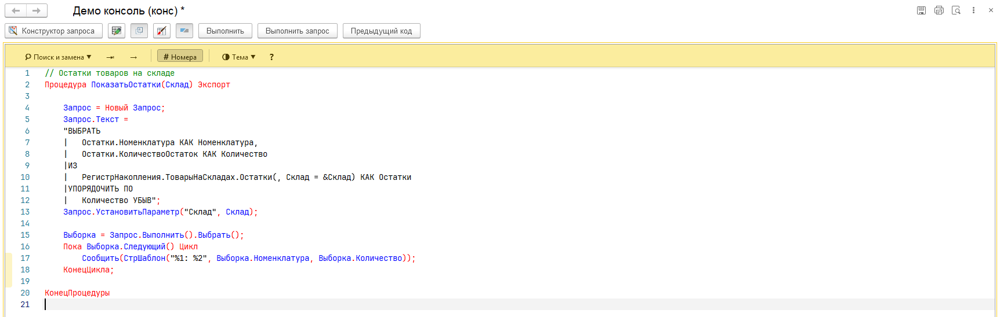
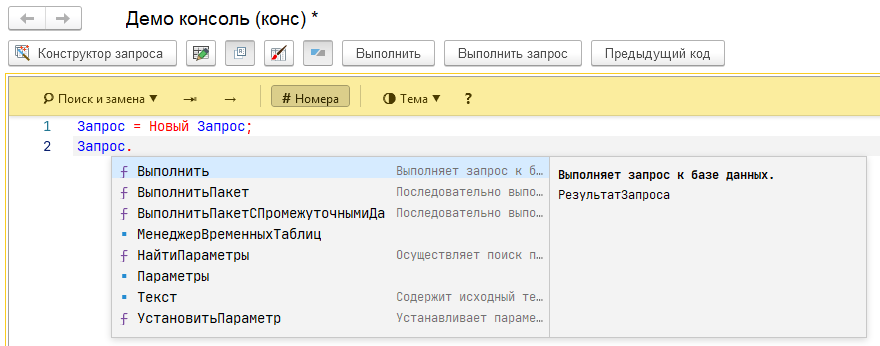
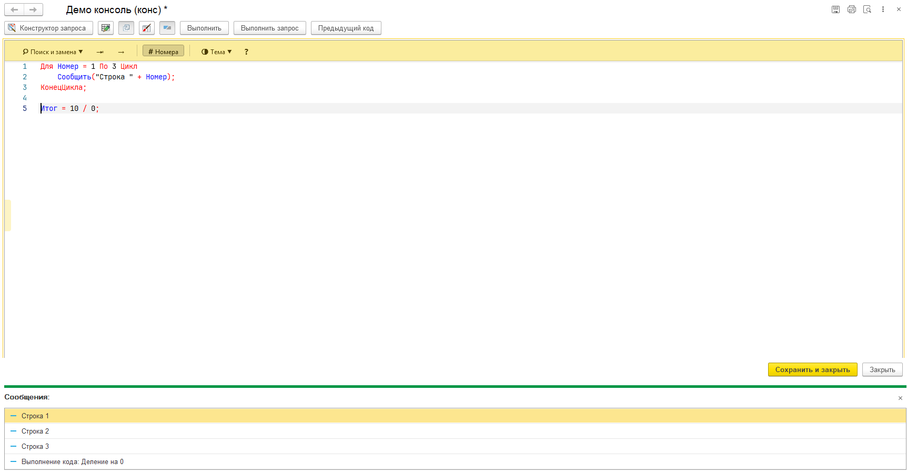
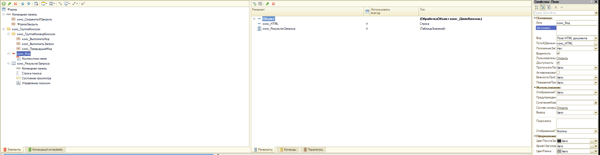
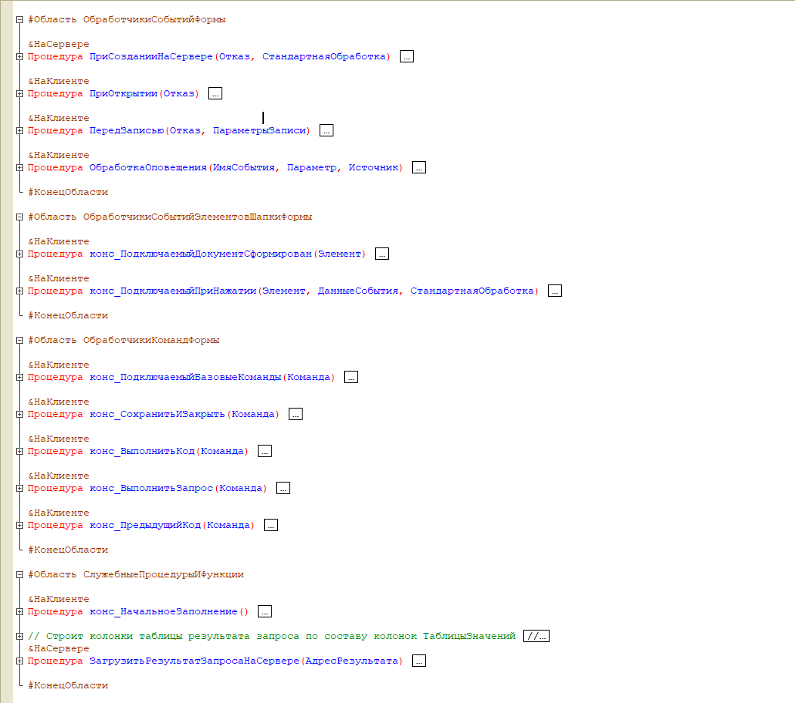

# Встраиваемая консоль кода для 1С

Редактор кода 1С с подсветкой, подсказками и выполнением кода, который встраивается в любую управляемую форму
вашей конфигурации. Поставляется расширением конфигурации.




Разработка основана на [консоли кода для управляемых форм](https://infostart.ru/1c/tools/1266087/).
Публикация на Инфостарте: <https://infostart.ru/1c/tools/2178741/>.

## Возможности

- **Подсветка синтаксиса** встроенного языка и языка запросов, нумерация строк, сворачивание блоков, поиск и замена.
- **Контекстные подсказки**: методы и свойства типов платформы с описанием, метаданные конфигурации, общие модули.

  

- **Конструктор запроса** и конструктор форматной строки прямо из редактора.
- **Выполнение кода и запросов** на сервере по кнопке или `Ctrl+Enter`. Выполняется выделенный фрагмент
  или весь текст, сообщения кода выводятся в окно сообщений.
  Доступно пользователям с ролью `конс_ВыполнениеКода` или правом администрирования.

  

- **История выполнения**: последние выполненные фрагменты можно вернуть в редактор.
- **Переход к определению** (`F12`, `Ctrl+клик`) в текущем тексте и в общих модулях, если задан каталог
  исходников конфигурации (константа `конс_КаталогИсходников`).
- **Темы оформления** и сохранение настроек редактора для пользователя.
- **Несколько текстов на одной форме**: код каждой страницы сохраняется при переключении.
- **Программный интерфейс** для управления редактором из кода формы: текст, выделение, закладки, маркеры ошибок,
  режим «только чтение» и другое (см. обработку `конс_ДемоКонсольКоманды`).

## Состав расширения

| Объект | Назначение |
|---|---|
| `конс_ИнициализацияРедактораСервер` | создание служебных реквизитов и базовых команд консоли на форме |
| `конс_ИнициализацияРедактораКлиент` | показ консоли в поле HTML, инициализация редактора |
| `конс_КомандыРедактораКлиент` | программный интерфейс редактора и обработка событий консоли |
| `конс_ВыполнениеКодаВызовСервера` | выполнение кода и запросов, история выполнения |
| Макеты `конс_КонсольКода`, `конс_СинтаксисКонсоли` | сам редактор (одна HTML-страница) и справочник синтаксиса платформы |
| Роль `конс_ВыполнениеКода` | разрешает выполнение кода из консоли |

Демо-обработки:

- **конс_ДемоКонсоль** — консоль с выполнением кода и запросов, образец для встраивания в свои формы;
- **конс_ДемоКонсольКоманды** — вызовы программного интерфейса консоли;
- **конс_ДемоСтраницы** — форма с двумя страницами и отдельным кодом на каждой.

## Установка

1. Соберите расширение из исходников (каталог `src`, формат 1C:EDT) или загрузите готовый `.cfe`.
2. Подключите расширение к конфигурации: «Все функции → Стандартные → Управление расширениями конфигурации»
   или в конфигураторе.
3. Назначьте роль `конс_ВыполнениеКода` пользователям, которым разрешено выполнять код из консоли.
4. Откройте обработку `конс_ДемоКонсоль`.

## Встраивание в свою форму

1. Скопируйте с формы обработки `конс_ДемоКонсоль` реквизит формы `конс_HTML` (тип «Строка»).
2. Скопируйте с той же формы группу `конс_ГруппаКонсоли` со всеми дочерними элементами. В ней поле `конс_Код`
   вида «Поле HTML документа» с путем к данным `конс_HTML`. Обработчики событий поля подключаются программно,
   в свойствах их заполнять не нужно. Кнопки базовых команд тоже создаются программно в группе
   `конс_ГруппаКомандКонсоли`.

   

3. Перенесите код модуля формы `конс_ДемоКонсоль` в модуль своей формы. Если обработчики `ПриСозданииНаСервере`,
   `ПриОткрытии` и `ПередЗаписью` уже есть, добавьте вызовы консоли в их конец.

   

4. В свойствах формы, в разделе «События», привяжите `ПриСозданииНаСервере`, `ПриОткрытии` и `ПередЗаписью`
   к скопированным процедурам.
5. Чтобы код сохранялся вместе с объектом, добавьте в объект конфигурации реквизит для текста консоли
   (в демо-обработке — `конс_Код`) и используйте его в `ПередЗаписью` и `конс_НачальноеЗаполнение`.

Минимальный код модуля формы:

```bsl
&НаСервере
Процедура ПриСозданииНаСервере(Отказ, СтандартнаяОбработка)
	// Истина - создать команды и кнопки по умолчанию в группе конс_ГруппаКомандКонсоли
	конс_ИнициализацияРедактораСервер.ПриСозданииНаСервере(ЭтотОбъект, Истина);
КонецПроцедуры

&НаКлиенте
Процедура ПриОткрытии(Отказ)
	конс_ИнициализацияРедактораКлиент.ПриОткрытии(ЭтотОбъект);
КонецПроцедуры

&НаКлиенте
Процедура конс_ПодключаемыйДокументСформирован(Элемент)
	конс_ИнициализацияРедактораКлиент.ДокументСформирован(Элемент, ЭтотОбъект);
	конс_НачальноеЗаполнение(); // начальный текст в редактор
КонецПроцедуры

&НаКлиенте
Процедура конс_ПодключаемыйПриНажатии(Элемент, ДанныеСобытия, СтандартнаяОбработка)
	конс_КомандыРедактораКлиент.ОбработатьСобытиеСУчетомРежимаЧтения(ЭтотОбъект, ДанныеСобытия.Event.eventData1C);
КонецПроцедуры

&НаКлиенте
Процедура конс_ПодключаемыйБазовыеКоманды(Команда)
	конс_КомандыРедактораКлиент.ВыполнитьБазовуюКоманду(ЭтотОбъект, Команда);
КонецПроцедуры
```

## Как это устроено

- При создании формы текст редактора (макет `конс_КонсольКода`) и справочник синтаксиса платформы
  (макет `конс_СинтаксисКонсоли`) помещаются во временное хранилище формы.
- `ПриОткрытии` присваивает текст редактора реквизиту `конс_HTML` поля HTML. Временные файлы и расширение
  работы с файлами не нужны.
- Когда редактор готов (событие `EVENT_EDITOR_READY`), в него передаются справочник синтаксиса и список
  общих модулей.
- С параметром `Истина` на форме создаются команды «Конструктор запроса», «Только для чтения», «Быстрые подсказки»,
  «Подсветка запросов», «Строка состояния» и кнопки для них в начале группы `конс_ГруппаКомандКонсоли`
  (если группы нет — в командной панели формы). Команды и кнопки, уже размещенные на форме, не дублируются.
- Редактор — облегченная сборка с программным интерфейсом, совместимым с Monaco Editor.

## Требования

- Платформа 1С:Предприятие **8.3.24** и новее (режим совместимости расширения 8.3.24).
- Сборка расширения и проверка модулей конфигуратором выполнялись на платформе 8.3.27.1989.
- Для разработки — 1C:EDT.

## Лицензия

[MIT](LICENSE)
